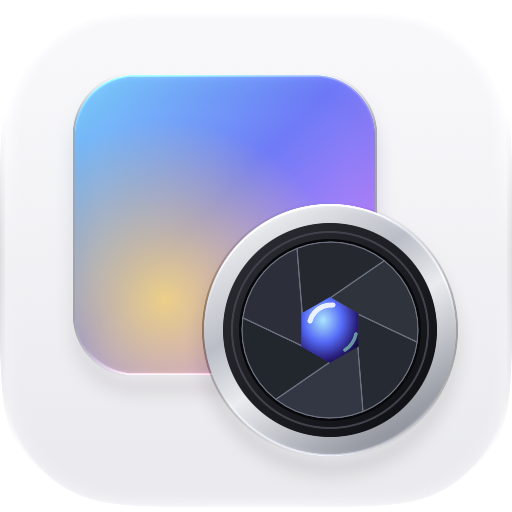
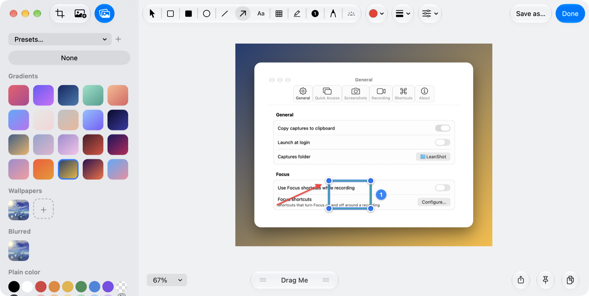

<p align="center"></p>

<h1 align="center">LeanShot</h1>

<p align="center">A native macOS app for screenshots, annotation and screen recording, inspired by CleanShot X.</p>



LeanShot lives in the menu bar and captures an area, a window, the full screen or a scrolling page. After each capture, a small card appears in the corner of the screen, so you can copy, save, drag or annotate the image right away. The app is written in Swift with AppKit, it has no third-party dependencies, and it builds with the Command Line Tools.

## Install

Download `LeanShot-0.3.2.dmg` from the [latest release](https://github.com/danihrndzld/LeanShot/releases/latest), open it, and drag LeanShot to Applications.

The app is signed with an Apple Development certificate, but it is not notarized, so macOS blocks the first launch. To open it, right-click LeanShot in Applications and choose Open, then confirm. If macOS still refuses, run the following command once:

```sh
xattr -dr com.apple.quarantine /Applications/LeanShot.app
```

LeanShot needs Screen Recording permission to capture anything. When the permission is missing, the app shows a button that opens the right pane in System Settings. Microphone and camera permissions are only needed for recordings that use them, and Accessibility is only needed for automatic scrolling capture and the keystroke overlay.

LeanShot requires macOS 14 or later. Screen recording with audio requires macOS 15 or later, and the Liquid Glass design appears on macOS 26 or later.

## Capture

You start a capture from the menu bar icon or with a global shortcut. macOS reserves `⌘⇧3`, `⌘⇧4` and `⌘⇧5`, so LeanShot uses `⌃⇧` instead.

| Shortcut | Action |
|---|---|
| `⌃⇧4` | Capture an area |
| `⌃⇧5` | Capture a window |
| `⌃⇧3` | Capture the full screen |
| `⌃⇧2` | Recognize text or a QR code, on device |
| `⌃⇧6` | Start or stop a screen recording |
| `⌃⇧1` | Open the All-in-One picker |

You can change these shortcuts in Settings, and you can add a shortcut to any other menu action, e.g., scrolling capture, the self-timer, Pin Last Capture or Capture History.

The menu also has these capture modes:

- Frozen area capture freezes the screen first, so menus and hover states stay visible while you select. It can also capture an exact width and height.
- Scrolling capture stitches a long page from several frames. You scroll and press Return to add each frame, or you start automatic scrolling with A, and you finish with `⌘Return`.
- The self-timer lets you select an area first. A countdown from 5 to 1 then appears, and the countdown is never part of the image.

## Quick Access cards

After a capture, LeanShot shows a card in the corner of the screen where you work. When you hover over the card, the image blurs and shows Copy, Save, Pin, Annotate and Share, so the buttons are readable on any screenshot. You can drag the card into another app, and you can dismiss it with a two-finger swipe to the left or right. A quick flick throws the card off even when it moved only a little.

Copy puts both PNG and TIFF on the clipboard. Browser apps such as Figma, Notion and Linear read the PNG, and older Mac apps read the TIFF.

## Annotate

Double-click a card, or choose Annotate Last Capture, to open the editor. The toolbar has these tools, each with a single-key shortcut:

| Key | Tool |
|---|---|
| `V` `R` `F` `E` | Select, rectangle, filled rectangle, ellipse |
| `L` `A` `T` `D` | Line, arrow, text, pen |
| `X` `U` `P` | Blur and redact, Gaussian blur, black bar |
| `M` `C` `H` `K` | Highlighter, numbered counter, spotlight, crop |

Every new shape stays selected, so you can move it or drag its blue handles right away. Double-click a text annotation to edit it. The editor remembers your last tool, color, stroke width and styles for the next capture.

An arrow's head sits where you start the drag, and the drag pulls the tail. The arrow style menu offers Standard, Fancy, Curved, Double and Outline.

The text tool has a size menu from 10 to 216 pt and seven styles: Standard, Rounded, Outlined, Mono, Box, Mono Box and Rounded Box. New text uses Box, which draws the text in its color on a pale box of the same color. A style, size or color you pick also changes the selected text or arrow.

The highlighter finds the text in the screenshot. Over text, its cursor shrinks to the height of the line under it, and a drag follows that one line horizontally and stops where its text ends. Away from text, it draws a free box. On a dark screen the highlight lightens the area, and on a light screen it darkens it, so the text stays readable on both.

The blur and redact tool has four styles. Pixelate and Gaussian Blur hide content visually, and a slider sets the pixel size or the blur radius. Secure Blur pixelates the area twice on different grids with a blur in between, so the original text can't be rebuilt from the block averages. Black Bar replaces the pixels completely, and you should use it for passwords and other secrets.

The Background button, or the B key, opens a sidebar for presentation backgrounds. It offers 20 gradients, your desktop picture, your own wallpapers, plain colors and a transparent background, and sliders set the padding, inset, shadow and corner radius. You can save a background as a named preset.

Done saves the annotated image as PNG and copies it to the clipboard. When the capture already lives in your captures folder, Done replaces it and moves the original to the Trash, so you can still recover it. Save As exports PNG, JPEG or HEIC. Save Editable Project writes a `.leanshot` file that keeps the original image and every annotation layer. If you close or quit with unsaved annotations, LeanShot asks whether to save or discard them.

These are the main editor shortcuts:

| Shortcut | Action |
|---|---|
| `⌘S` or Return | Done |
| `⌘⇧S` | Save As |
| `⌘Z` and `⌘⇧Z` | Undo and redo |
| `⌘C`, `⌘V` and `⌘D` | Copy, paste and duplicate the selected shape |
| `⌘⇧C` | Copy the whole screenshot |
| `⌘⇧P` | Pin the screenshot above other windows |
| `[` and `]` | Decrease and increase the tool size |

Settings lists every shortcut, including the zoom keys and the arrow keys for nudging.

## Pin, history and recording

A pinned screenshot floats above other windows. You can move it, resize it with the scroll wheel, lower its opacity, or make it ignore clicks. Its menu can also copy it, save it or open it in the editor.

Capture History lists every file in your captures folder with a thumbnail, its size and its age. You can search by name with `⌘F`, preview with Space, open with Return, copy with `⌘C`, and move a file to the Trash with `⌘⌫`.

On macOS 15 or later, LeanShot records the display, a selected area or a window as an H.264 MP4 file at 30 or 60 fps. The window picker is the standard macOS picker. Recordings can include system audio, the microphone, a camera bubble, highlighted clicks and the keys you press. The video editor trims the recording, changes its speed and aspect ratio, adds zooms that follow the cursor, and exports MP4 or GIF.

## Build from source

You need the Xcode Command Line Tools on macOS 14 or later.

```sh
git clone https://github.com/danihrndzld/LeanShot.git
cd LeanShot
./build.sh
open build/LeanShot.app
```

`build.sh` signs the app ad hoc by default. Ad hoc signatures change on every build, so macOS asks for Screen Recording permission again after each rebuild. To keep the permission, set `SIGN_ID` to a stable signing identity:

```sh
SIGN_ID="Apple Development: you@example.com" ./build.sh
```

SwiftPM records SDK 14.0 in the binary, and AppKit then draws the app without Liquid Glass. `build.sh` uses `vtool` to record the real SDK version, so run the app from `build/LeanShot.app` to see the native design.

Other scripts in the repository:

- `scripts/make_dmg.sh` builds a signed app and packs it in a signed DMG.
- `scripts/make_icon.sh` compiles the Icon Composer document `Resources/LeanShot.icon` with Xcode's `actool`. You only need it after editing the icon, and it requires Xcode 26 or later.

## Tests and benchmarks

LeanShot has a built-in test runner, so you don't need XCTest or a full Xcode install.

```sh
swift run -c release LeanShot --selftest
swift run -c release LeanShot --bench
```

The self-test runs 69 regression tests in about 3 seconds, and each test checks one behavior. They cover cropping and rotation at Retina resolution, undo and redo, editable projects, the four redaction styles, backgrounds, history filtering, scrolling capture, video export and OCR. The self-test also checks that no two shortcuts collide, and that copies and exports produce valid PNG, JPEG and HEIC data.

The end-to-end tests open the real editor through the same entry point Finder uses, then send real mouse and key events to the editor window. They check what a user would see, e.g., the saved file, its pixels, the clipboard, the Trash and the save or discard sheet. Run them with `scripts/e2e.sh`, which also measures code coverage. GitHub Actions runs the self-test and the end-to-end tests on every push and pull request.

The benchmark times the slow paths on a 3024 by 1964 pixel capture, e.g., PNG encoding, a canvas redraw while dragging, and a step of the redaction slider. On an Apple silicon Mac, a canvas redraw while dragging takes about 1.3 ms.

## Project layout

The source code lives in `Sources/LeanShot`. `Annotate.swift` holds the editor, `QuickAccess.swift` holds the cards and pinned screenshots, and `main.swift` holds the menu bar app and the global shortcuts. `docs/ARCHITECTURE.md` describes how the parts fit together and the conventions the code follows.
